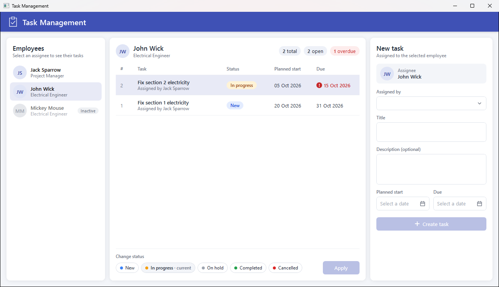

# TaskManagement

A desktop application for managing employees' tasks: assign work to colleagues, plan start and due dates,
and track every task through its lifecycle.



## Tech stack

| Area | Technology |
|------|------------|
| Platform | .NET 10, C# |
| UI | WPF, MVVM ([CommunityToolkit.Mvvm](https://github.com/CommunityToolkit/dotnet)) |
| Dependency injection | Microsoft.Extensions.DependencyInjection |
| Data access | Entity Framework Core 10 with migrations and seed data |
| Database | PostgreSQL 16 ([Npgsql EF Core provider](https://www.npgsql.org/efcore/)), snake_case naming via [EFCore.NamingConventions](https://github.com/efcore/EFCore.NamingConventions) |
| Infrastructure | Docker Compose |
| Testing | xUnit, integration tests against a real PostgreSQL |

## Architecture

The solution `TaskManagement.slnx` has three projects in `src/`:

| Project | Responsibility |
|---------|----------------|
| `TaskManagement.Domain` | Entities (`Employee`, `TaskItem`), task statuses and business rules. No external dependencies. |
| `TaskManagement.Data` | `DbContext`, entity configurations, migrations, seed data, and services (`ITaskService`, `IEmployeeService`) that return DTOs. |
| `TaskManagement.UI` | WPF application: view models, styles, converters and the `StatusSelector` custom control. |

Dependencies point inward: `UI → Data → Domain`.

Tests live in `tests/TaskManagement.Tests` (see [Tests](#tests)).

`StatusSelector` is a lookless custom control. Its behaviour lives in `Controls/StatusSelector.cs` and its
template in `Themes/Generic.xaml`. It uses dependency properties with change and coerce callbacks, a routed
event, a routed command and visual states.

## Getting started

### Prerequisites

- Windows (WPF)
- [.NET 10 SDK](https://dotnet.microsoft.com/download)
- [Docker Desktop](https://www.docker.com/products/docker-desktop/)
- EF Core CLI: `dotnet tool install -g dotnet-ef`

### Run

```powershell
# 1. Start PostgreSQL
docker compose up -d

# 2. Create the schema and seed data
dotnet ef database update -p src/TaskManagement.Data -s src/TaskManagement.Data

# 3. Start the application
dotnet run --project src/TaskManagement.UI
```

The connection string is taken from the `TASKDB_CONNECTION` environment variable. If it is not set,
the defaults from `docker-compose.yml` are used:

```
Host=localhost;Port=5432;Database=taskmanagement;Username=postgres;Password=postgres
```

### Migrations

Add a migration after changing the model or the seed data:

```powershell
dotnet ef migrations add <Name> -p src/TaskManagement.Data -s src/TaskManagement.Data
```

Or from the Visual Studio Package Manager Console:

```powershell
Add-Migration <Name> -Project TaskManagement.Data -StartupProject TaskManagement.Data
```

## Tests

`tests/TaskManagement.Tests` contains two kinds of tests:

- **Domain** – business rules of `TaskItem`; no database needed.
- **Integration** – `TaskService` and `EmployeeService` against a real PostgreSQL. Each test class gets its own
  throwaway database (`taskmanagement_test_<guid>`), created with the real migrations and dropped afterwards.

The integration tests need a running PostgreSQL server:

```powershell
docker compose up -d
dotnet test
```

To use another server, set `TASKDB_TEST_CONNECTION`. The database name in it is ignored, because each test class
creates its own database, so the user needs permission to create databases:

```powershell
$env:TASKDB_TEST_CONNECTION = "Host=myhost;Port=5432;Username=postgres;Password=secret"
dotnet test
```

## License

[MIT](LICENSE)
